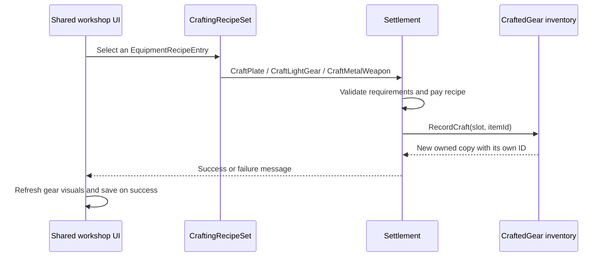
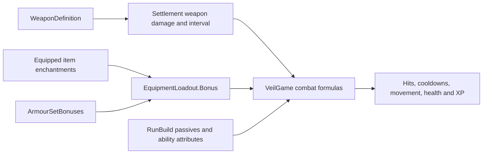

# Worked code flows

[Back to the code guide](README.md) · [Class reference](Classes.md)

The snippets use the `Veilbound` namespace and assume an existing `Settlement town`, unless stated otherwise. They demonstrate model operations; scene refresh, navigation and saving remain the responsibility of the calling gameplay/UI flow.

## 1. Look up a definition versus an owned copy

```csharp
var tinChest = ArmourCatalog.Find((int)ArmourSlot.Chest, Metals.Item(0));
var tinSword = WeaponCatalog.Find(0);

// Shared, read-only definition data:
string name = tinSword.Name;
float damage = tinSword.Damage;
float interval = tinSword.AttackInterval;
float weight = tinSword.Weight;

// An owned copy is found by its unique instance ID, not its catalogue ID:
CraftedGear owned = town.FindRoll(instanceId);
WeaponDefinition profile = owned?.WeaponDefinition;
```

`WeaponCatalog.Find(0)` describes a Tin greatsword. `town.FindRoll(0)` searches for an owned instance whose unique ID is zero; these operations are not interchangeable. A piece of armour also needs its slot to resolve its definition, because the same material item code is used across multiple slots.

Definition constructors are internal. Normal callers use the catalogues rather than constructing a new definition for every owned item.

## 2. Craft an item



Example using a supported recipe set:

```csharp
var recipes = town.EquipmentRecipes(EquipmentRecipeKind.Weapon);
var tinSwordRecipe = recipes.Entry(0, 0);

if (recipes.Craft(tinSwordRecipe, out string message))
{
    CraftedGear created = town.FindRoll(town.lastCraftedRollId);
    // The caller can now select/compare this owned copy.
}
```

This can legitimately return `false` for a new town: workshop level, research and resource requirements still apply. `Affordable(entry)` is useful for display, but the craft operation remains responsible for final validation/payment.

For direct operations, the current entry points are `CraftPlate(slot, metalIndex, out message)`, `CraftLightGear(slot, material, tier, out message)` and `CraftMetalWeapon(weaponItemId, out message)`.

`RecordCraft` creates inventory records without paying recipe costs. It is used by the validated craft flow and by test fixtures; do not replace player-facing crafting with a direct `RecordCraft` call. Crafting an already-equipped slot does not silently replace the player's selected copy. An empty armour slot can auto-equip its first craft through the existing record operation.

## 3. Equip and compare

```csharp
CraftedGear candidate = town.FindRoll(candidateId);
if (candidate != null)
{
    var equipped = town.EquippedRoll(candidate.slot);
    var preview = new GearComparisonData(candidate, equipped, town.Loadout);

    // preview.primary: this item's armour/weight or weapon damage/timing changes.
    // preview.bonuses: enchantment and set-threshold effects for the projected outfit.

    bool equippedSuccessfully = town.EquipRoll(candidate.id);
}
```

`EquipRoll` updates the saved item-code selection and equipped-instance ID together. Writing only one backing array can produce a visible item with missing per-copy enchantment effects, or a stale equipped identity.

In the active UI, `EquipInventoryItem` wraps this model operation, calls `RefreshMetalGear`, updates selections and saves. `RebuildHero` refreshes presentation; it is not where item damage or set bonuses are defined.

A comparison preview reads the candidate and current loadout without paying resources, saving or temporarily equipping the item. Supplying the loadout is important: replacing the fourth Heavy piece with a fourth Cloth piece should preview losing regeneration and gaining area, even if neither item has enchantments.

## 4. Read sets and enchantments independently

```csharp
ArmourSetBonuses sets = town.Loadout.Sets();
int heavyCount = sets.Heavy;
float regenerationFromSet = sets.Bonus("regen");

CraftedGear chest = town.EquippedRoll((int)ArmourSlot.Chest);
float regenerationFromThisChest = GearRollRules.Value(chest, "regen");

// Includes all equipped enchantments plus applicable set bonuses:
float totalEquipmentRegeneration = town.GearBonus("regen");
```

A bare character has no armour set. Body slots 0–7 are counted once each. Capes, weapons, unequipped copies and material tier differences do not add extra set pieces. At eight pieces both the four-piece and eight-piece effects remain active.

Enchantment values live on owned copies. Set bonuses are derived results and are never inserted into the item's `enchantments` array. For example, eight Heavy pieces plus a chest enchanted with +0.2 HP/sec give +0.5 HP/sec equipment regeneration while using one item enchantment slot.

## 5. Use the Mystic

```csharp
// Random stat, first enchantment slot. Category/stat arguments are unused in random mode.
bool added = town.EnchantGear(instanceId, 0, 0, "", 0, out string message);
```

The integer method/target conventions are:

| Input | Meaning |
| --- | --- |
| `mode = 0` | Random stat; available with Mystic level 1. |
| `mode = 1` | Choose a category; requires Mystic level 3. |
| `mode = 2` | Choose a specific stat; requires Mystic level 4. |
| `target = 0` | First item enchantment slot. |
| `target = 1` | Second slot; requires Mystic level 2. |

A preflight call to `EnchantmentRequirement` supplies the UI's failure reason. `EnchantGear` validates again, pays Veil Essence and adds/replaces only the selected slot. It rejects a third slot, duplicate stat selections, invalid ownership and no-op replacements without charging.

`MysticRules.Strength` and `Cost` use current material progression policy. Old saved enchantment values are preserved rather than recalculated on load. Retired crafting `affixes` do not contribute to stats. The screen handler `ApplyMysticEnchantment` saves on success; the model method does not itself write a save file.

## 6. How equipment reaches combat



Examples of the current consumers:

- `MaxHealth` combines base health, equipment vitality and run vitality. Armour value provides protection, not an automatic health conversion.
- `Damage` starts with `Settlement.WeaponDamage`, then applies relevant bonuses. Ability damage also uses `WeaponRules.Coefficient` and ability attributes.
- `SkillAttackRate` uses weapon timing and Haste reduction, then independently applies Leather's direct attack-speed multiplier.
- `Step` applies equipment and run regeneration during active combat.
- `UpdateShards` applies `GearExperience` and run XP bonuses to actual collected XP.
- `AreaMultiplier` uses equipment area and current-run upgrades.

Names and UI previews should read the same definition/calculation paths. Adding a damage number only to a tooltip does not change an actual hit; changing a prefab's name does not change its profile.

## 7. Queue work and advance production

```csharp
// One Tin weapon goal. The planner can arrange missing supplies.
bool queued = town.QueueSettlementJob(
    4, "", 0, 9, 1, 0, out string message);
```

This is a high-level goal. It differs from manually queuing a paid batch through a processing line:

```csharp
ProcessingLine bars = town.ProcessingLine(3);
bool batchQueued = bars.Queue(0, 2, out string message);
```

The batch requires its input materials and valid workshop/research state. The goal planner can identify missing inputs and coordinate automatic supply. The UI refreshes the settlement plan and saves after accepting a goal.

The clock path is `VeilGame.Update` → `Settlement.Tick` → `TickTechnology`. The latter advances construction, research, raw gathering and processing around relevant completion boundaries. Manual assignments/batches, repeats and automatic goals share the saved stock and slot state; do not add a second independent timer in a new menu.

### Identifier tables

The following integers are compatibility encodings, not freely interchangeable enum values:

| Armour/inventory slot | Meaning |
| --- | --- |
| 0–7 | Helm, Shoulders, Chest, Gloves, Belt, Bracers, Legs, Boots. |
| 8 | Cape. |
| 9 | Main-hand weapon. |
| 10 in paper-doll UI | Display-only off-hand position; not an additional saved equipment slot. |

| Resource family | Meaning |
| --- | --- |
| 0 | Raw ore resources. |
| 1 | Raw hide resources. |
| 2 | Raw textile/fibre resources. |
| 3 | Refined bars, including distinct Veilcrystal variants. |
| 4 | Processed leather. |
| 5 | Processed cloth. |

Wood, stone and Essence also have dedicated `Settlement` fields. Do not assume a raw family/index points to a finished crafting input. `ResourceAmount`/`AddResource` handle legacy storage aliases; avoid directly indexing the backing resource arrays in new features.

| Settlement job kind | Goal |
| --- | --- |
| 0 | Building construction/upgrade. |
| 1 | Research. |
| 2 | Bars. |
| 3 | Plate armour. |
| 4 | Weapon. |
| 5 | Cloth/leather equipment. |
| 6 | Processed leather. |
| 7 | Processed cloth. |

Armour material codes are 1 = Cloth, 2 = Leather, 3 = Plate/Heavy. A plate item code is usually `100 + metalIndex`; legacy 31/32 still resolve. Light-gear encoding is handled by `LightGear.Item`/`Tier`/`Material` and should not be recreated by new arithmetic. Weapon profile IDs are -1 for Wooden and 0–10 for craftable profiles. `equippedMetalWeapon = -2` is the old wooden-selection sentinel, not the canonical weapon definition ID. Owned instance IDs and catalogue string IDs are different identifiers again.

## 8. Save and reload

The normal profile flow is:

1. `VeilGame.Save()` delegates to the active-character save flow.
2. `SavedCharacter.Capture` records appearance/progression and `CharacterInventory`.
3. `CharacterSaveStore.TownJson` serializes a town copy with character inventory/progression fields stripped out.
4. The store journals the intended character/town/index update and writes files with temporary-file replacement and backups.
5. Loading validates records/revisions, recovers interrupted operations where possible and applies character inventory back to the town instance.
6. `EnsureGear`, `EnsureGearRolls`, `EnsureIndustry` and related helpers normalize older saved state and rebuild non-serialized adapters as needed.

`CharacterInventory.Capture` is not a deep clone: it transfers references before serialization. For an isolated test fixture, use the established JSON roundtrip or the save-store test pattern rather than mutating a supposed snapshot's arrays.

The normal profile root is `Application.persistentDataPath/characters-v1`; settings use `settings-v1.json` alongside that root. The legacy settlement file and separate smoke paths are retained. Personal saves are outside the repository and are not backed up by a Git push.
