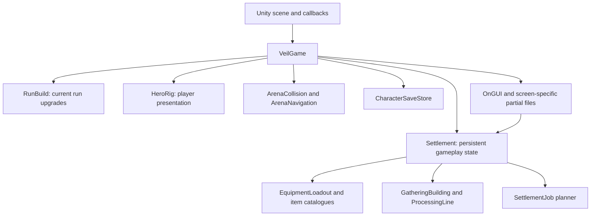
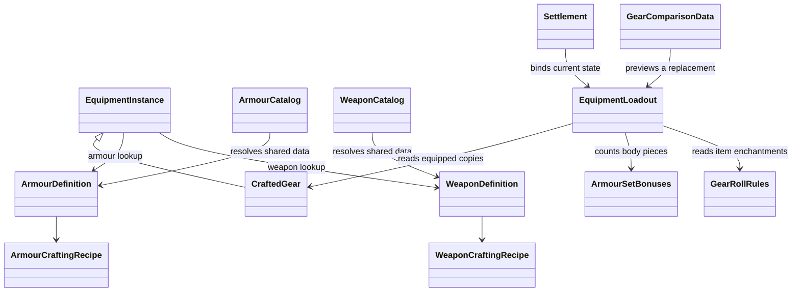

# The Veilbound code guide

This is the developer entry point for understanding the game, finding its classes and making changes safely. It describes the current source, including the armour and weapon domain features, as of **5 November 2026**. Those features were developed on separate branches; the version you see on GitHub depends on which branch or PR you open.

Read this overview first, then use:

- [Class reference](Classes.md): what the important classes own, who calls them and how to use them.
- [Worked flows](Flows.md): crafting, equipping, enchanting, combat, production and saving from beginning to end.
- [Development tasks](Development.md): where to change a rule, how to add content, and which checks to run.
- [Complete source index](SourceIndex.md): linked C# files and declared types, including partial classes and editor/test tools.
- [Equipment details](../EquipmentArchitecture.md), [weapon details](../WeaponArchitecture.md) and [GitHub workflow](../GitHubWorkflow.md).

## 1. The overall structure

The game is a Unity project using C#. The main namespace is `Veilbound`. The playable scene is [HollowCourt.unity](../../Assets/Veilbound/Scenes/HollowCourt.unity), and the central runtime component is [VeilGame](../../Assets/Veilbound/Scripts/VeilGame.cs).

There are three broad kinds of code:

| Kind | Meaning | Examples |
| --- | --- | --- |
| Runtime coordination and UI | Receives Unity callbacks, routes input, changes screens, runs gameplay and draws menus. | `VeilGame` and its partial files. |
| State, definitions and services | Stores progression or describes/calculates gameplay without being a separate scene component for every item. | `Settlement`, `RunBuild`, `ArmourDefinition`, `WeaponDefinition`, `EquipmentLoadout`, `ProcessingLine`. |
| Unity presentation and authoring | Creates, animates or renders GameObjects; imports/generates assets and builds players. | `ProductionHeroVisual`, `MasterPlateEquipment`, model catalogues and classes in `Editor/`. |

These arrows show the main relationships, not a claim that every dependency has already been isolated behind an interface.

## 2. What a class means here

A **definition** describes a kind of thing. A **runtime instance** represents one owned or active thing. A **service** calculates or performs an operation. A **Unity component** is attached to a GameObject and can receive Unity lifecycle callbacks.

For example, all Tin chest copies resolve the same `ArmourDefinition`. Each owned chest has a separate `CraftedGear`/`EquipmentInstance` with its own ID and enchantments. The on-character mesh is controlled by `MasterPlateEquipment`; it is not the inventory item object.

| C# / Unity form | How it is used in this project |
| --- | --- |
| Ordinary class | Created or obtained through game code, rather than attached to a GameObject. `EquipmentLoadout` and `HeroRig` are examples. |
| `static class` | Shared catalogue or rule functions, such as `WeaponCatalog`, `Metals` and `HasteRules`. There is no `new WeaponCatalog()`. |
| `MonoBehaviour` | Unity scene component, such as `VeilGame` or `ProductionHeroVisual`. |
| `ScriptableObject` | Unity asset containing shared configuration/references, such as `ProductionModelCatalog` and `GreatswordVisualLibrary`. The current item definitions themselves are C# catalogue objects. |
| `struct` | Small value type used for results or records, such as `ResourceCost`, `GearStatChange` and `ArmourSetBonuses`. |
| `partial class` | Multiple source files compiled into **one class**. It does not create a separate system object for each file. |

## 3. The two large partial classes

### `VeilGame`

`VeilGame` is still the main coordinator. Files such as `GameUI.cs`, `InventoryScreen.cs`, `EnemyCombat.cs`, `RageVirtue.cs` and `RelicPointers.cs` add members to the same class. They can access its private state directly.

It owns the active screen, the current `Settlement`, the current `RunBuild`, player health/XP/timers, the hero rig, enemy/projectile collections, cameras and many UI selections. Nested records such as `Foe`, `Shard`, `Hazard` and `Bolt` are managed through that coordinator.

There is therefore still significant shared coupling. A file named `EnemyCombat.cs` is a useful source grouping; it is not yet a standalone `EnemyCombat` service. The new equipment classes provide a more explicit boundary that can be followed for future refactors.

### `Settlement`

`Settlement` is a serializable gameplay-state object, not a scene component. Its partial files hold town resources, buildings, research, inventory, equipment selections, work orders and progression. Its public methods provide operations such as crafting, equipping, adding resources and ticking production.

Some newer objects wrap that saved state instead of copying it: `GatheringBuilding`, `CraftingBuilding`, `ProcessingLine` and `EquipmentLoadout`. A new runtime wrapper can be rebuilt after loading; the serialized state remains in `Settlement`.

## 4. Startup and the frame loop

The important entry points are in [VeilGame.cs](../../Assets/Veilbound/Scripts/VeilGame.cs):

1. `Awake()` determines normal versus smoke-test startup, loads/migrates state and preferences, creates lighting/camera/world groups, rebuilds the hero and sets the initial screen. Normal startup enters character selection; smoke startup selects a review coroutine.
2. `Update()` routes input to the open screen, advances active simulation, updates presentation/camera and periodically saves.
3. `OnGUI()` in [GameUI.cs](../../Assets/Veilbound/Scripts/GameUI.cs) routes immediate-mode UI drawing to the appropriate screen.
4. `StartRun()` initializes an expedition. `Step(dt)` advances active combat. `EndRun(...)` resolves the result, and `ReturnHome()` returns to settlement.
5. `Save()` uses the character-slot store during normal profile-based play, with a legacy/smoke settlement-file path also retained.

The simulation gate is explicit: `SimulationActive` is true for settlement and expedition. Paused, choice, result and other screens do not advance town simulation through that gate. `Settlement.Tick(seconds, multiplier)` converts elapsed active seconds into city hours; one minute at multiplier 1 equals one city hour. Tests can freeze simulation with the smoke-review flag.

## 5. Equipment ownership and calculations

- Definitions own base item data or resolve it through the existing material rules.
- Instances own identity and item-specific enchantments.
- Set bonuses come from equipped armour types, not from enchantment slots.
- `EquipmentLoadout` reads the loadout and calculates totals. Its replacement calculation does not temporarily equip the candidate.
- UI and combat consume those calculated results.
- Existing item IDs and serialized field names are retained for save compatibility.

The public `Settlement.Loadout` adapter first ensures/migrates its backing data and binds the calculator. The calculator is read-only after binding; the adapter should not be assumed to skip legacy normalization on first access.

## 6. UI, simulation and visuals are separate concepts

A weapon's `Damage` and `AttackInterval` come from `WeaponDefinition`. Its rendered GameObject is selected by `StarterEquipment` and the visual library. Its actual attack is executed by the combat members of `VeilGame`. Its tooltip uses `GearItemMetrics` and the same definition data.

Similarly, changing an armour mesh does not inherently change armour stats, and adding an enchantment does not alter a set count. Keeping these distinctions prevents a visual fitting fix from accidentally becoming a balance change.

## 7. Where code and assets live

| Location | Purpose |
| --- | --- |
| `Assets/Veilbound/Scripts/` | Main runtime state, rules, UI, gameplay and review harnesses. |
| `Assets/Veilbound/Scripts/EquipmentDomain/` | Shared armour/weapon definitions, owned-item base model, loadout calculations and set/enchantment rules. |
| `Assets/Veilbound/Editor/` | Editor-only imports, validations, diagnostics and build entry points. |
| `Assets/Veilbound/Resources/` | Runtime-loadable assets such as model catalogues, UI art and motion sets. |
| `Assets/VeilboundPlateMasters/Runtime/` | Modular plate/body equipment presentation. |
| `Assets/VeilboundGreatswords/Runtime/` | Greatsword visual library. |
| Other model-specific folders under `Assets/` | Imported models, generated Unity assets and supporting runtime/editor code. |
| Root `*AssetProduction/` folders | Original art sources, exports, pipelines and isolated validation projects. They are not the live gameplay scripts under `Assets/Veilbound/Scripts`. |
| `Docs/Validation/` | Committed verification results and selected review captures. |
| `Builds/` | Local executables, excluded from Git. A feature executable can differ from `Builds/Integrated`. |

## 8. Practical reading order

1. This overview and the equipment sections of [Classes.md](Classes.md).
2. `EquipmentInstance`, `ArmourDefinition`, `WeaponDefinition`, `EquipmentLoadout` and `GearComparisonData`.
3. The crafting/equipping/enchanting examples in [Flows.md](Flows.md).
4. `VeilGame.Awake`, `Update`, `StartRun`, `Step` and `GameUI.OnGUI`.
5. `Settlement`, production wrappers and `CharacterSaveStore`.
6. [Development.md](Development.md) before changing content or save fields.

The source remains the authority for exact values and behavior. When a rule changes, update its tests and the relevant guide in the same feature branch.
